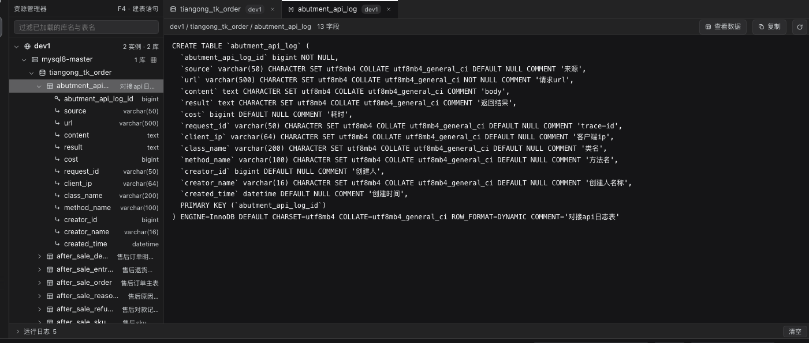

# 数据窗口

一个 DataGrip 风格的数据库窗口：**不新建任何连接配置**，直接读工作区自己的配置，解析出各环境的主机、库与账号，然后在同一个窗口里浏览实例 / 库 / 表 / 字段，并为每个库开一个只读 SQL 工作台。

## 它是怎么找到数据库的

项目里通常只写占位符，真正的主机和账号在运维配置里：

```
bootstrap.yml            spring.application.name = demo-order-service
                         spring.cloud.nacos.config.server-addr = ${nacos.config-server:https://nacos-dev...}
       ↓
~/nacos/config/.../snapshot-tenant/dev1/${group}/demo-order-service
                         spring.datasource.url = jdbc:mysql://${acme.dbs.mysql-master}/demo_order
       ↓
~/nacos/config/.../snapshot-tenant/dev1/${group}/<放变量的 data-id>（示例 yunwei-db.yml，名字由项目决定）
                         acme.dbs.mysql-master = mysql.internal.example.com:3306
                         acme.dbs.demo_order_service.username / .passwd
```

窗口按同样的顺序解析，所以：

- **环境**来自本地 Nacos 快照（`dev1` / `qa2` / `uat3` …）；
- 多个 Nacos 缓存都有同名租户时，以项目 `bootstrap.yml` 里 `server-addr` 指向的那个缓存为准，不会把另一套集群的主机混进来；
- 解析结果按工作区缓存到 `$DSH_HOME/storages/dsh-data-window/workspaces/<hash>-<目录名>.json`（权限 0600），**一个工作区一份**，配置文件的时间戳变了才重新解析。

占位符支持嵌套默认值（`${新名字:${旧名字}}`，项目改名时的常见写法），按花括号配对解析。

**只列本项目声明的数据源**：快照里其它 data-id 声明的实例不会进树——它们属于别的项目，本窗口也没有它们的账号。占位符在哪个文件里定义由项目自己决定（`yunwei-db.yml`、`db.yml`、`datasource.yml` 或别的名字都行），窗口按占位符去找定义它的 data-id，不假定文件名；工作区自己没有 `spring.datasource` 时，树是空的，并提示检查应用名与 Nacos 快照。

## 规则认不出来时：AI 兜底

规则只认识"Spring + Nacos + 占位符"这一类形态；项目换个配置方式（`.properties`、K8s ConfigMap、手写 `db.json`、拆分字段的 host/port），树就会是空的。这时可以让模型读一遍工作区：

1. **触发**：打开工作区没解析到任何环境、且还没选过模型时，窗口自动弹窗让你选模型；之后随时可以点工具栏的「AI 分析」再跑一次。
2. **选模型**：弹窗列出 DSH 里已配置的提供方与模型（和 `/model` 用的是同一份目录、同一套 `provider` / `model` 参数），并默认预选 **DSH 当前默认模型**（带「DSH 默认」标记）。选择存进设置（浏览器本地），在「设置 → 数据窗口 → AI 兜底」里可以随时更换。
3. **只发脱敏片段**：Host 在工作区里挑出与地址/账号相关的文件片段（`.yml/.yaml/.properties/.json/.toml/.env/...`，单文件 6KB、合计 60KB、最多 40 个文件），所有密码类键值在发出去之前替换成 `<redacted>`。
4. **模型只指路**：要求返回严格 JSON（host / port / database / user / 密码所在文件 + 键路径 + 证据行号），**不返回密码本身**；Host 按文件 + 键路径自己取值，路径被限制在工作区内（含符号链接检查）。
5. **真连验证**：每个候选都用只读连接实测一次（`SELECT VERSION()`），连得上的才进树；连不上的写进运行日志和结果面板，不会留下"看着有、点开报错"的节点。
6. **结果**：验证通过的库挂在左侧树的 **AI** 环境分组下，和规则解析出来的环境并列，可以正常展开表、执行 SQL。

限制：

- 需要 Host 侧有 LLM 服务（DSH 已配置至少一个模型提供方）；没有时弹窗会说明不可用。
- 单次分析最长 2 分钟，模型一次最多提议 12 个候选；同一工作区同一模型的结果在 Host 内存里缓存，文件没变就不重复调用。
- AI 分组的事实来源仍然是"真实连接"，模型只是候选生成器；它编出来的地址会在验证阶段被丢掉。

## 选择要显示的库（勾选面板）

树里默认只列**本项目配置声明的库**。同一个实例上通常还有别的库（例如配置里是 `bw_order`，实例上还有 `bw_inventory`、`bw_temu`…），但要由你来挑：

1. 展开实例，点右侧的网格按钮「选择数据库…」（也可以右键实例 →「选择数据库…」；实例一个库都没配置时，展开就会直接弹出来）；
2. 弹窗列出该实例上的全部库，勾选要显示的（**配置里的库固定勾选**，带「配置」标记，不能取消）；
3. 点「应用」→ 树里只显示勾选的库，这份选择同时记到当前工作区；
4. 下次打开工作区（包括重启应用）直接就是这份选择；
5. 想改：再打开同一面板重新勾；想移除某个库，取消勾选即可。

实现上只保存"实例 id + 库名"（`$DSH_HOME/storages/dsh-data-window/remembered/<hash>-<目录名>.databases.json`，0600），凭据复用实例自己的连接，不额外存密码；查询仍然走只读网关。

## 手动添加连接

有些库根本不在工作区里：本地 Docker、共享测试实例、客户机房的一套副本。工具栏的「添加连接」可以在任何工作区里手动加一个：

| 字段 | 说明 |
|---|---|
| 从已保存的连接带出 | 列出本机其它工作区解析过、或手动添加过的连接（主机:端口 · 账号 · 环境）。选中后自动填好主机、端口、账号和库，**密码复用那条连接已保存的凭据**，不再输入 |
| 环境名称 | 树的顶层分组名，例如「本地」「测试库」「客户 A」（`prod` 这种也对）；同名会合并成一个环境。**留空则用「主机:端口」**；从已保存连接导入时会自动沿用来源的环境名 |
| 主机 / 端口 | 默认 `127.0.0.1:3306` |
| 用户名 / 密码 | 密码可以为空（例如本机 root） |
| 数据库（可选） | 留空只添加实例，进树后用实例上的「选择数据库…」挑选要显示的库 |

- **保存前先连一次**：用只读网关跑 `SELECT VERSION()`，连不上直接报服务器的错误，不写入任何东西。
- **存放位置**：`$DSH_HOME/storages/dsh-data-window/manual/<hash>-<目录名>.manual.json`，权限 0600，只属于这个工作区；密码只存在这里和 Host 内存里，浏览器只拿 `i:…` / `d:…`。
- **移除单个连接**：在树里右键该实例 →「移除此连接」，对应的连接池也会关闭。
- **删除整个环境**：右键环境行 →「删除环境」（会二次确认）。这个环境下的连接、已选的库一起移除，树里不再显示；**需要时可以从其它工作区重新导入**——删除的是本工作区的选择，不是本机已知的连接目录。
- **重命名环境**：右键环境行 →「重命名环境」；改的是显示分组名，**这个环境里已选的库会跟着迁移**，不会丢。
- 手动连接与规则/AI 的结果共享同一套只读校验和查询路径，不因为"手动"放宽任何限制。
- 「从已保存的连接带出」只读本机插件自己存的两类文件（`workspaces/*.json` 的发现缓存、`manual/*.manual.json`），**密码不下发浏览器**：保存时由 Host 按来源 id 取回并写进这条新连接，所以它之后是自包含的。

## 功能

| 需求 | 实现 |
|---|---|
| 点工作区自动加载配置、缓存地址与账号 | 打开面板即解析工作区 → 环境 → 实例 → 库，结果按工作区缓存；`重新读取配置` 强制刷新 |
| 看到实例、库、表、字段 | 左侧树逐层展开；实例上的网格按钮打开「选择数据库」勾选面板，表可展开字段（类型、主键、NOT NULL、注释） |
| 快捷键查看建表语句 | 选中表后按 **F4** 或 **⌘/Ctrl + Shift + D**；也可右键「查看建表语句」 |
| 每个库一个 SQL 工作台 | 点库名打开该库的工作台，标签页常驻 |
| 每张表一个窗口 | 双击表打开/聚焦该表自己的标签，并在末尾追加一条 `SELECT *` 基础查询；重复双击不会新开标签、不覆盖已有内容，且只执行刚追加的那一条 |
| 代码工作区联动 | 代码工作区右键实体类（`@TableName`）直接打开该表并执行基础查询；右键 Mapper 方法把 XML/注解里的 SQL 粘贴到数据窗口（不自动执行）。契约见 `docs/BRIDGE.md` |
| 规则之外的兜底 | 规则 → AI 分析 → 手动添加连接，三条路产出的库都经只读连接验证后才进树 |
| SQL 高亮 | 关键字、函数、字符串、数字、注释分色显示，颜色跟着深/浅色主题可读 |
| 字段提示 | 输入时列出表、字段、关键字；`别名.` 只列该表字段；数据来自 Host 一次性读取的库结构，每库缓存 |
| 一键格式化 | 编辑栏「格式化」：子句换行、select 列表一行一项、join 与 and 缩进，关键字大小写保持原样 |
| 运行日志 | 每条执行语句（含总行数刷新用的 `COUNT`）都以 `SQL` 行记入日志，失败语句也会记录 |
| 总行数 | 结果栏「共 — 行」旁的刷新按钮按当前语句执行一次 `COUNT(*)`，统计前会去掉最外层的 `LIMIT`（子查询里的保留）；只读、按需触发 |
| 控制台持久化 | 每个工作区的 SQL 存成 Host 文件（`workspaces/<hash>-<名字>.consoles.json`，0600），切换工作区、刷新或重启后自动恢复；关掉标签即删除；只恢复语句，不恢复结果 |
| 设置页 | DSH 设置里独立一页「数据窗口」：进入时收起侧栏、默认行数上限、快捷键与控制台保存位置 |
| 全局快捷键 | 默认 `⌘3`（Windows/Linux `Ctrl+3`）在任意界面打开数据窗口；设置页「快捷键」可修改/恢复默认 |
| 界面配色 | 跟随 `dsh-ide-window` 选择的主题（同一套 `dsh-theme` 契约）；没有选择时跟随 DSH 默认配色 |
| 窗口内切换工作区 | 点标题左侧的工作区名，弹出工作区列表，选中即切换，不用回侧栏 |
| 调整列表宽度 | 拖动资源管理器与工作台之间的分隔条；双击分隔条恢复默认宽度 |
| 进入即全宽 | 进入数据窗口时自动收起 DSH 侧栏；工具栏按钮可随时展开或收起 |

## 只读保证

- 语句白名单：`SELECT` / `WITH` / `SHOW` / `DESC` / `EXPLAIN` / `TABLE`；
- 一次请求只允许一条语句；
- 语句体内出现 `insert/update/delete/drop/alter/truncate/...` 直接拒绝（含 `WITH ... DELETE`、`SELECT ... INTO OUTFILE`、`FOR UPDATE`）；
- 每条连接建立后执行 `SET SESSION TRANSACTION READ ONLY`，即使静态检查漏了，**数据库本身也会拒绝写入**。

## 配置项（`cordis.patch.yml` 里的 `config`）

| 键 | 默认 | 说明 |
|---|---|---|
| `nacosHome` | `~/nacos` | Nacos 本地缓存根目录 |
| `groups` | 全部 | 只读这些 group，例如 `[business]` |
| `envOrder` | `dev1, dev, qa2, qa1, ...` | 环境在树里的排序 |
| `connectTimeoutMs` | `8000` | 建连超时 |
| `statementTimeoutMs` | `60000` | 单条语句超时（`max_execution_time`），`0` 关闭 |
| `connectionLimit` | `4` | 每个目标的连接池大小 |
| `defaultLimit` | `200` | 默认行数上限（面板里可改到 2000） |
| `cache` | `true` | 关闭后每次打开都重新解析 |

## 界面




> 截图裁掉了宿主的侧栏与 Git 面板。示例是一个 `demo-shop` 演示工作区（`demo` 环境 / `mysql-main` 实例 / `mysql` 系统库，经本地 `127.0.0.1` 转发），不含真实主机、业务库表或个人信息。

## 已知边界

- 只支持 MySQL / MariaDB（读的是 `jdbc:mysql://` 与 `information_schema`）。
- 需要本机已有 Nacos 快照缓存，并且工作区自己的配置里有 `spring.datasource`；缺一个，规则解析就是空的（不会再拿快照里其它 data-id 声明的实例兜底）。此时可以用「AI 分析」兜底，但它同样要求 Host 有可用的模型，并且候选必须连得上。
- 账号密码由工作区配置提供，窗口不保存第二份；每个工作区一份 0600 缓存，只含该项目的解析结果，删掉它等于只“忘记”这一个项目。
- 同一时刻只连一个实例的库：跨库查询请用 `库名.表名`。
