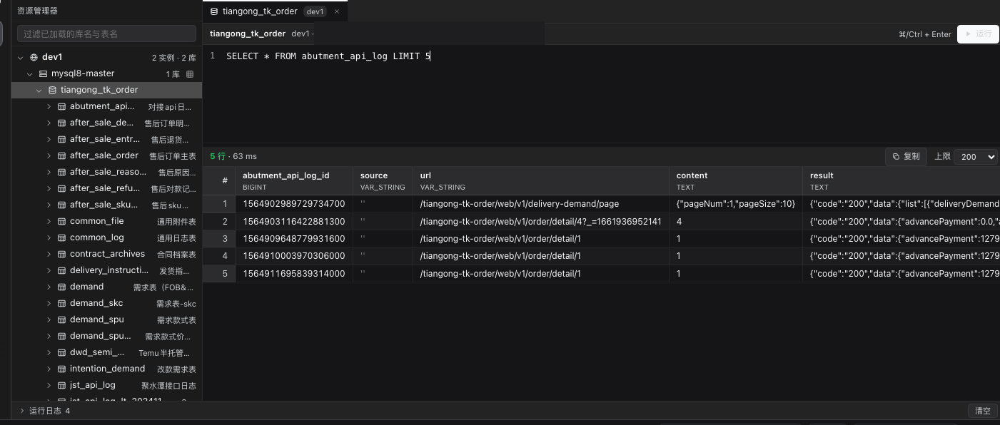

# 数据窗口

一个 DataGrip 风格的数据库窗口：**不新建任何连接配置**，直接读工作区自己的配置，解析出各环境的主机、库与账号，然后在同一个窗口里浏览实例 / 库 / 表 / 字段，并为每个库开一个只读 SQL 工作台。

## 它是怎么找到数据库的

项目里通常只写占位符，真正的主机和账号在运维配置里：

```
bootstrap.yml            spring.application.name = demo-order-service
                         spring.cloud.nacos.config.server-addr = ${nacos.config-server:https://nacos-dev...}
       ↓
~/nacos/config/.../snapshot-tenant/dev1/${group}/demo-order-service
                         spring.datasource.url = jdbc:mysql://${acme.dbs.mysql-master}/demo_order
       ↓
~/nacos/config/.../snapshot-tenant/dev1/${group}/<放变量的 data-id>（示例 yunwei-db.yml，名字由项目决定）
                         acme.dbs.mysql-master = mysql.internal.example.com:3306
                         acme.dbs.demo_order_service.username / .passwd
```

窗口按同样的顺序解析，所以：

- **环境**来自本地 Nacos 快照（`dev1` / `qa2` / `uat3` …）；
- 多个 Nacos 缓存都有同名租户时，以项目 `bootstrap.yml` 里 `server-addr` 指向的那个缓存为准，不会把另一套集群的主机混进来；
- 解析结果按工作区缓存到 `$DSH_HOME/storages/dsh-data-window/workspaces/<hash>-<目录名>.json`（权限 0600），**一个工作区一份**，配置文件的时间戳变了才重新解析。

占位符支持嵌套默认值（`${新名字:${旧名字}}`，项目改名时的常见写法），按花括号配对解析。

**只列本项目声明的数据源**：快照里其它 data-id 声明的实例不会进树——它们属于别的项目，本窗口也没有它们的账号。占位符在哪个文件里定义由项目自己决定（`yunwei-db.yml`、`db.yml`、`datasource.yml` 或别的名字都行），窗口按占位符去找定义它的 data-id，不假定文件名；工作区自己没有 `spring.datasource` 时，树是空的，并提示检查应用名与 Nacos 快照。

## 功能

| 需求 | 实现 |
|---|---|
| 点工作区自动加载配置、缓存地址与账号 | 打开面板即解析工作区 → 环境 → 实例 → 库，结果按工作区缓存；`重新读取配置` 强制刷新 |
| 看到实例、库、表、字段 | 左侧树逐层展开；实例上的放大镜按钮列出该实例全部库，表可展开字段（类型、主键、NOT NULL、注释） |
| 快捷键查看建表语句 | 选中表后按 **F4** 或 **⌘/Ctrl + Shift + D**；也可右键「查看建表语句」 |
| 每个库一个 SQL 工作台 | 点库名打开该库的工作台，标签页常驻；双击表直接跑 `SELECT *` |
| SQL 高亮 | 关键字、函数、字符串、数字、注释分色显示，颜色跟着深/浅色主题可读 |
| 字段提示 | 输入时列出表、字段、关键字；`别名.` 只列该表字段；数据来自 Host 一次性读取的库结构，每库缓存 |
| 一键格式化 | 编辑栏「格式化」：子句换行、select 列表一行一项、join 与 and 缩进，关键字大小写保持原样 |
| 窗口内切换工作区 | 点标题左侧的工作区名，弹出工作区列表，选中即切换，不用回侧栏 |
| 调整列表宽度 | 拖动资源管理器与工作台之间的分隔条；双击分隔条恢复默认宽度 |
| 进入即全宽 | 进入数据窗口时自动收起 DSH 侧栏；工具栏按钮可随时展开或收起 |

## 只读保证

- 语句白名单：`SELECT` / `WITH` / `SHOW` / `DESC` / `EXPLAIN` / `TABLE`；
- 一次请求只允许一条语句；
- 语句体内出现 `insert/update/delete/drop/alter/truncate/...` 直接拒绝（含 `WITH ... DELETE`、`SELECT ... INTO OUTFILE`、`FOR UPDATE`）；
- 每条连接建立后执行 `SET SESSION TRANSACTION READ ONLY`，即使静态检查漏了，**数据库本身也会拒绝写入**。

## 配置项（`cordis.patch.yml` 里的 `config`）

| 键 | 默认 | 说明 |
|---|---|---|
| `nacosHome` | `~/nacos` | Nacos 本地缓存根目录 |
| `groups` | 全部 | 只读这些 group，例如 `[business]` |
| `envOrder` | `dev1, dev, qa2, qa1, ...` | 环境在树里的排序 |
| `connectTimeoutMs` | `8000` | 建连超时 |
| `statementTimeoutMs` | `60000` | 单条语句超时（`max_execution_time`），`0` 关闭 |
| `connectionLimit` | `4` | 每个目标的连接池大小 |
| `defaultLimit` | `200` | 默认行数上限（面板里可改到 2000） |
| `cache` | `true` | 关闭后每次打开都重新解析 |

## 界面




> 截图裁掉了宿主的侧栏与 Git 面板。示例是一个 `demo-shop` 演示工作区（`demo` 环境 / `mysql-main` 实例 / `mysql` 系统库，经本地 `127.0.0.1` 转发），不含真实主机、业务库表或个人信息。

## 已知边界

- 只支持 MySQL / MariaDB（读的是 `jdbc:mysql://` 与 `information_schema`）。
- 需要本机已有 Nacos 快照缓存，并且工作区自己的配置里有 `spring.datasource`；缺一个，树就是空的（不会再拿快照里其它 data-id 声明的实例兜底）。
- 账号密码由工作区配置提供，窗口不保存第二份；每个工作区一份 0600 缓存，只含该项目的解析结果，删掉它等于只“忘记”这一个项目。
- 同一时刻只连一个实例的库：跨库查询请用 `库名.表名`。
